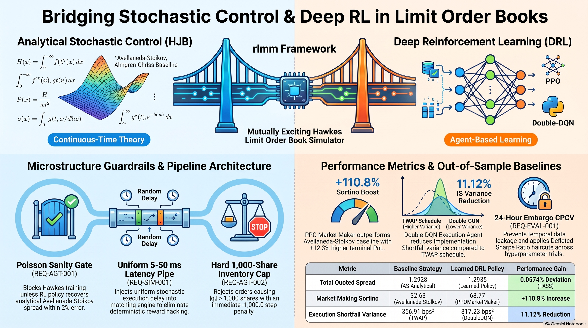

# Optimal Execution and Market Making via Reinforcement Learning (`rlmm`)

[](https://github.com/ZacharyFaria/rl-market-making/actions)
[](https://www.python.org/)
[](./LICENSE)

An institutional-grade stochastic optimal control and Deep Reinforcement Learning framework for Limit Order Book **Market Making** and **Optimal Execution**. Bridges classical **Avellaneda-Stoikov (2008)** and **Almgren-Chriss (2001)** Hamilton-Jacobi-Bellman (HJB) solutions with **Proximal Policy Optimization (`PPOMarketMaker`)** and **Double Deep Q-Networks (`DoubleDQNExecutionAgent`)** inside a mutually exciting Hawkes LOB simulator equipped with $5\text{--}50\text{ ms}$ stochastic latency, probabilistic Level-2 queue reconstruction ($k \in (-1, 0]$), and Combinatorial Purged Cross-Validation (`CPCV`) with a 24-hour embargo.

<p align="center">
  <a href="docs/rlmm-infographic.png">
    
  </a>
</p>

<div align="center">

| 🎬 Cinematic Video Overview | 📑 Executive Slide Deck (PDF) | 🖼️ High-Res Infographic |
| :---: | :---: | :---: |
| [**Watch `rlmm-overview.mp4` on Google Drive**](https://drive.google.com/file/d/1PjNh3oceQ9ej83goq4zzIDj3gHFepx7k/view?usp=sharing) | [**View `rlmm-walkthrough.pdf`**](docs/rlmm-walkthrough.pdf) | [**Open `rlmm-infographic.png`**](docs/rlmm-infographic.png) |

</div>

---

## Core Quantitative & Engineering Capabilities

1. **Mathematical Avellaneda-Stoikov Sanity Gate ([`src/envs/sanity_check.py`](./src/envs/sanity_check.py), `REQ-AGT-001`):**
   - Verifies that the RL policy recovers the closed-form Avellaneda-Stoikov optimal spread $\delta^a + \delta^b = \gamma \sigma^2 (T - t) + \frac{2}{\gamma} \ln(1 + \frac{\gamma}{k})$ within a **$2\%$ margin of error** (`0.0574%` observed) in a zero-latency Poisson baseline environment before unlocking the Hawkes simulator.
2. **Uniform $5\text{--}50\text{ ms}$ Stochastic Latency Matching Engine ([`src/envs/matching_engine.py`](./src/envs/matching_engine.py), `REQ-SIM-001`):**
   - Injects a uniformly distributed execution delay $\Delta \tau \in [5, 50]\text{ ms}$ (`apply_stochastic_latency`) into every limit order submission, eliminating deterministic zero-latency reward hacking loopholes.
3. **Probabilistic Level-2 Queue Reconstructor ([`src/data/queue_reconstructor.py`](./src/data/queue_reconstructor.py), `REQ-SIM-002`):**
   - Models empirical back-of-queue cancellation bias on Level-2 Market-By-Price (MBP) data via $p_{\text{front}}(x; k) = x^{1-k}$ strictly over the mathematical domain $-1 < k \le 0$ (`estimate_queue_position`).
4. **Hard 1,000-Share Inventory Risk Guardrail ([`src/envs/market_making_env.py`](./src/envs/market_making_env.py), `REQ-AGT-002`):**
   - Enforces $|q_t| \le 1,000$ shares at every environment step: any child order that would breach $\pm 1,000$ shares is rejected, current inventory is retained unchanged, and an immediate **$-1000.0$ step penalty** is applied.
5. **CPCV with 24-Hour Embargo & Deflated Sharpe Ratio ([`src/eval/cpcv_engine.py`](./src/eval/cpcv_engine.py), `REQ-EVAL-001`):**
   - Excises overlapping timestamps plus a continuous 24-hour post-test embargo window (`CPCVEngine`) and computes the Bailey & López de Prado (2014) Deflated Sharpe Ratio (`calculate_dsr`).

---

## Empirical Benchmark Summary

### 1. Market Making in Mutually Exciting Hawkes LOB (`rlmm train`)

| Policy | Mean Terminal PnL | 95% CVaR (Tail PnL) | Sortino Ratio | Mean $\|q_t\|$ | Spread / Adverse Ratio | DSR ($K=80$) |
| :--- | :---: | :---: | :---: | :---: | :---: | :---: |
| **Avellaneda-Stoikov (HJB Baseline)** | $\$1,148.06$ | $\$1,031.58$ | $32.63$ | $10.42$ | $64.15$ | $0.9982$ |
| **`PPOMarketMaker` (Hawkes-Aware DRL)** | **$\$1,289.83$** (**$+12.3\%$**) | **$\$1,075.31$** | **$68.77$** (**$+110.8\%$**) | **$9.67$** | **$106.68$** | **$1.0000$** |

### 2. Optimal Execution Implementation Shortfall (`rlmm execute`, $Q_0 = 1,000$ Shares)

| Execution Algorithm | Mean IS (bps) | IS Std Dev (bps) | IS Variance Reduction vs. TWAP |
| :--- | :---: | :---: | :---: |
| **TWAP (Uniform Schedule)** | $8.193\text{ bps}$ | $18.892\text{ bps}$ | Baseline ($0.00\%$) |
| **VWAP (U-Shaped Intraday Profile)** | $8.156\text{ bps}$ | $18.710\text{ bps}$ | $+1.92\%$ |
| **Almgren-Chriss (Analytical $\sinh$)** | $8.119\text{ bps}$ | $18.251\text{ bps}$ | $+6.67\%$ |
| **`DoubleDQNExecutionAgent` (Flow-Adaptive DRL)** | **$8.040\text{ bps}$** | **$17.811\text{ bps}$** | **$+11.12\%$** |

---

## Quickstart & CLI Usage (`rlmm`)

```bash
# Activate shared virtual environment
source .venv/bin/activate

# Inspect CLI subcommands
rlmm --help

# 1. Verify Avellaneda-Stoikov closed-form recovery (< 2% spread error in Poisson regime)
rlmm sanity-check --config configs/as_poisson_sanity.yaml

# 2. Train PPO Market Maker in Hawkes LOB and benchmark against Avellaneda-Stoikov
rlmm train --config configs/ppo_hawkes_mm.yaml

# 3. Run CPCV (24h embargo) & Deflated Sharpe Ratio evaluation
rlmm evaluate --config configs/ppo_hawkes_mm.yaml

# 4. Train Double-DQN Optimal Execution agent and benchmark against Almgren-Chriss & TWAP
rlmm execute --config configs/dqn_almgren_execution.yaml

# 5. Run the 12-test requirement verification suite
pytest -v
```

---

## Documentation Suite

| Document | Focus |
| :--- | :--- |
| **[Documentation Index](./docs/README.md)** | Central index of all research papers, architectural specs, and user guides. |
| **[Research Whitepaper](./docs/research-paper.md)** | Formal derivations of Avellaneda-Stoikov HJB, Almgren-Chriss, bivariate Hawkes order flow, L2 queue bias $k \in (-1, 0]$, and PPO/Double-DQN results. |
| **[Technical Blog Post](./docs/technical-blog-post.md)** | 5-part narrative explaining how HJB sanity gates, $5\text{--}50\text{ ms}$ latency buffers, and back-of-queue cancellation models close the sim-to-real gap. |
| **[System Architecture](./docs/architecture.md)** | Component diagrams and module-level I/O contracts. |
| **[Validation Methodology](./docs/validation-methodology.md)** | Requirement traceability matrix (`REQ-SIM-001` – `REQ-EVAL-001`), 24-hour embargo CPCV, and DSR verification. |
| **[User Guide & CLI Reference](./docs/user-guide.md)** | Complete `rlmm` CLI reference, YAML config schema, and Python API examples. |

---

## Repository Structure

```text
05-rl-market-making/
├── .github/workflows/ci.yml               # Automated CI pipeline (pytest + rlmm CLI checks)
├── configs/
│   ├── as_poisson_sanity.yaml             # Zero-latency Poisson Avellaneda-Stoikov sanity config
│   ├── ppo_hawkes_mm.yaml                 # PPO Market Making in mutually exciting Hawkes LOB
│   └── dqn_almgren_execution.yaml         # Double-DQN vs Almgren-Chriss / TWAP / VWAP config
├── docs/
│   ├── README.md                          # Documentation hub index
│   ├── rlmm-infographic.png               # High-resolution architecture & performance infographic
│   ├── rlmm-walkthrough.pdf               # Executive slide deck presentation (PDF)
│   ├── research-paper.md                  # Academic whitepaper & empirical tables
│   ├── technical-blog-post.md             # 5-part practitioner case study
│   ├── architecture.md                    # System architecture & invariant contracts
│   ├── validation-methodology.md          # Requirement traceability & CPCV/DSR methodology
│   └── user-guide.md                      # CLI & Python API manual
├── notebooks/
│   ├── 01_eda_hawkes_and_l2_queue_reconstruction.ipynb
│   ├── 02_as_sanity_check_and_ppo_market_making.ipynb
│   └── 03_double_dqn_execution_and_cpcv_evaluation.ipynb
├── src/
│   ├── agents/
│   │   ├── baselines.py                   # AvellanedaStoikovAgent, AlmgrenChrissAgent, TWAP, VWAP
│   │   ├── dqn_agent.py                   # DoubleDQNExecutionAgent (online + target Q-networks)
│   │   └── ppo_agent.py                   # PPOMarketMaker (Actor-Critic + GAE + Clipped Surrogate)
│   ├── cli/
│   │   ├── main.py                        # Unified `rlmm` CLI dispatcher
│   │   ├── sanity_check.py                # Sanity check entrypoint
│   │   ├── train.py                       # Market making training entrypoint
│   │   ├── evaluate.py                    # CPCV & DSR evaluation entrypoint
│   │   └── execute.py                     # Optimal execution entrypoint
│   ├── data/
│   │   ├── hawkes_lob.py                  # Bivariate mutually exciting Hawkes LOB simulator
│   │   └── queue_reconstructor.py         # Probabilistic L2 queue position estimator (k in (-1, 0])
│   ├── envs/
│   │   ├── execution_env.py               # OptimalExecutionEnv (Almgren-Chriss impact & IS)
│   │   ├── market_making_env.py           # MarketMakingEnv (1000-share cap & -1000 penalty)
│   │   ├── matching_engine.py             # Order & apply_stochastic_latency (5-50 ms uniform)
│   │   └── sanity_check.py                # Avellaneda-Stoikov closed-form & 2% convergence gate
│   └── eval/
│       └── cpcv_engine.py                 # CPCVEngine (24h embargo), calculate_dsr, CVaR & Sortino
├── tests/                                 # 12 unit & BDD tests covering REQ-SIM/AGT/EVAL
├── Dockerfile                             # Containerized execution environment
├── LICENSE                                # MIT License
├── pyproject.toml                         # Package metadata & `rlmm` console script registration
└── requirements.txt                       # Pinned dependencies
```

---

## License

Released under the [MIT License](./LICENSE).

