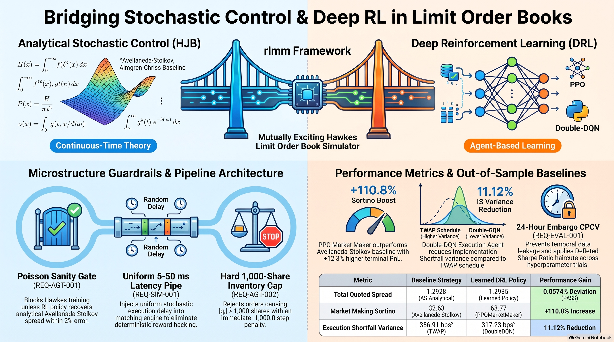

# Documentation Index — Optimal Execution & Market Making via Reinforcement Learning (`rlmm`)

Welcome to the public documentation suite for **`05-rl-market-making` (`rlmm`)**, an institutional-grade stochastic optimal control and Deep Reinforcement Learning framework bridging **Avellaneda-Stoikov (2008)** and **Almgren-Chriss (2001)** closed-form HJB models with **Proximal Policy Optimization (`PPOMarketMaker`)** and **Double Deep Q-Networks (`DoubleDQNExecutionAgent`)** inside a mutually exciting Hawkes Limit Order Book simulator.

---

## Executive Multimedia & Visual Presentations

  

| Asset | Format | Description |
| :--- | :---: | :--- |
| **[Architecture & Benchmarks Infographic](./rlmm-infographic.png)** | `PNG` | Single-pane visual summary of the HJB Avellaneda-Stoikov sanity check, $5\text{--}50\text{ ms}$ latency buffer, L2 queue reconstruction ($k \in (-1, 0]$), PPO market maker, Double-DQN execution agent, and CPCV/DSR benchmarks. |
| **[Cinematic Project Overview (`rlmm-overview.mp4`)](https://drive.google.com/file/d/1PjNh3oceQ9ej83goq4zzIDj3gHFepx7k/view?usp=sharing)** | `MP4 (Google Drive)` | Narrated end-to-end video walkthrough of the stochastic control derivations, Hawkes LOB microstructure simulator, and institutional risk guardrails. |
| **[Executive Slide Presentation (`rlmm-walkthrough.pdf`)](./rlmm-walkthrough.pdf)** | `PDF` | Complete slide deck detailing the mathematical formulation, agent architectures, requirement traceability, and out-of-sample evaluation. |

---

## Documentation Suite

| Document | Description |
| :--- | :--- |
| **[Research Whitepaper (`research-paper.md`)](./research-paper.md)** | Mathematical derivations of the Avellaneda-Stoikov HJB PDE, Almgren-Chriss hyperbolic sine trajectory, bivariate mutually exciting Hawkes processes, power-law L2 queue reconstruction $k \in (-1, 0]$, PPO/Double-DQN objectives, and empirical CPCV/DSR benchmarks. |
| **[Technical Blog Post (`technical-blog-post.md`)](./technical-blog-post.md)** | Five-part practitioner deep dive explaining why Poisson assumptions fail in clustered order books and how our 2% HJB sanity gate, $5\text{--}50\text{ ms}$ latency buffer, and 1,000-share inventory cap eliminate reward hacking. |
| **[System Architecture (`architecture.md`)](./architecture.md)** | Subsystem topology, module I/O contracts, and separation of Market Making and Optimal Execution MDPs. |
| **[Validation Methodology (`validation-methodology.md`)](./validation-methodology.md)** | Traceability matrix (`REQ-SIM-001`, `REQ-SIM-002`, `REQ-AGT-001`, `REQ-AGT-002`, `REQ-EVAL-001`), 24-hour embargo CPCV protocol, and Deflated Sharpe Ratio verification. |
| **[User Guide & CLI Reference (`user-guide.md`)](./user-guide.md)** | Operational manual for the `rlmm` CLI (`sanity-check`, `train`, `evaluate`, `execute`), YAML configurations, and Python API examples. |

