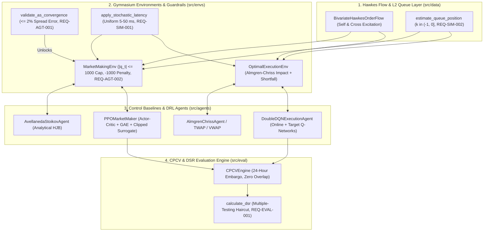

# System Architecture & Stochastic Control / DRL Specification

**Application:** `05-rl-market-making` (`rlmm`)  
**Package Entrypoint:** `rlmm = "src.cli.main:main"`  

---

## 1. End-to-End Subsystem Architecture

The `05-rl-market-making` repository cleanly separates the Market Making MDP (`MarketMakingEnv` + `PPOMarketMaker` + `AvellanedaStoikovAgent`) from the Optimal Execution MDP (`OptimalExecutionEnv` + `DoubleDQNExecutionAgent` + `AlmgrenChrissAgent` / `TWAP` / `VWAP`), sharing the underlying Hawkes order flow generator, $5\text{--}50\text{ ms}$ stochastic latency matching engine, probabilistic Level-2 queue reconstructor, and CPCV/DSR evaluation engine.

---

## 2. Module Engineering Contracts & Guardrails

| Module Path | Primary Symbols | Formal Contract / Guardrail | Verification Suite |
| :--- | :--- | :--- | :--- |
| [`src/envs/matching_engine.py`](../src/envs/matching_engine.py) | `Order`, `apply_stochastic_latency` | `apply_stochastic_latency(order, rng) -> int` injects an integer delay in $[5, 50]\text{ ms}$; prohibits zero or sub-$5\text{ ms}$ latency in Hawkes mode (`REQ-SIM-001`). | [`tests/test_matching_engine.py`](../tests/test_matching_engine.py) |
| [`src/data/queue_reconstructor.py`](../src/data/queue_reconstructor.py) | `estimate_queue_position` | `estimate_queue_position(volume_ahead, k) -> float` validates $-1 < k \le 0$ (raising `ValueError` outside $(-1, 0]$) and applies power-law back-of-queue cancellation bias (`REQ-SIM-002`). | [`tests/test_queue_reconstructor.py`](../tests/test_queue_reconstructor.py) |
| [`src/envs/sanity_check.py`](../src/envs/sanity_check.py) | `validate_as_convergence`, `run_poisson_sanity_check` | `validate_as_convergence(agent_spread, as_spread) -> bool` requires $\le 2\%$ deviation from analytical Avellaneda-Stoikov spread; blocks Hawkes initialization on failure (`REQ-AGT-001`). | [`tests/test_sanity_check.py`](../tests/test_sanity_check.py) |
| [`src/envs/market_making_env.py`](../src/envs/market_making_env.py) | `MarketMakingEnv` | `step(action) -> tuple[np.ndarray, float, bool, dict]` rejects any child order causing $\|q_t\| > 1000$, retains current inventory, and returns reward $-1000.0$ (`REQ-AGT-002`). | [`tests/test_market_making_env.py`](../tests/test_market_making_env.py) |
| [`src/envs/execution_env.py`](../src/envs/execution_env.py) | `OptimalExecutionEnv` | Models temporary impact $\eta v_t$, permanent impact $\kappa v_t$, and basis-point Implementation Shortfall relative to arrival mid-price $S_0$. | [`tests/test_agents_and_execution.py`](../tests/test_agents_and_execution.py) |
| [`src/agents/ppo_agent.py`](../src/agents/ppo_agent.py) | `PPOMarketMaker`, `ActorCriticNet` | Gaussian Actor-Critic trained with GAE ($\lambda=0.95$) and clipped surrogate objective ($\epsilon=0.20$). | [`tests/test_agents_and_execution.py`](../tests/test_agents_and_execution.py) |
| [`src/agents/dqn_agent.py`](../src/agents/dqn_agent.py) | `DoubleDQNExecutionAgent`, `QNetwork` | Decoupled online ($\theta$) and target ($\theta^-$) Q-networks optimizing state-contingent child-order participation multipliers. | [`tests/test_agents_and_execution.py`](../tests/test_agents_and_execution.py) |
| [`src/eval/cpcv_engine.py`](../src/eval/cpcv_engine.py) | `CPCVEngine`, `calculate_dsr`, `compute_cvar_95`, `compute_sortino` | `calculate_dsr(returns_array, trial_count, return_variance) -> float` and `CPCVEngine` with continuous 24-hour embargo (`REQ-EVAL-001`). | [`tests/test_cpcv_engine.py`](../tests/test_cpcv_engine.py) |

