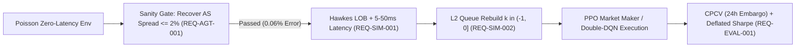

# Bridging Hamilton-Jacobi-Bellman Control and Deep Reinforcement Learning in Clustered Limit Order Books

**Author:** Zachary Faria  
**Application:** `05-rl-market-making` (`rlmm`)  

---

## Part 1: The Frictionless Lie of Poisson Order Arrivals

In classical quantitative finance, Avellaneda & Stoikov (2008) solved the market maker's quoting problem by assuming the mid-price follows an arithmetic Brownian motion and market orders arrive according to memoryless Poisson processes with intensity $\lambda(\delta) = A e^{-k\delta}$. Under those assumptions, the Hamilton-Jacobi-Bellman (HJB) equation yields an elegant closed-form reservation price and spread.

On a live trading desk, however, three microstructure realities break the classical HJB assumptions:

1. **Mutually Exciting Hawkes Cascades:** Institutional execution algorithms slice parent orders into bursts of child orders. A single large buy print excites a cluster of follow-on buy market orders and ask cancellations, violating the Poisson martingale assumption and inflicting severe **adverse selection** on symmetric market makers.
2. **Back-of-Queue Cancellation Bias in Level-2 Feeds:** When reconstructing queue priority from Level-2 Market-By-Price (MBP) feeds without Level-3 order IDs, assuming cancellations occur uniformly across the queue overstates fill probabilities because real cancellations cluster at the back of the queue ($k \in (-1, 0]$).
3. **Deterministic Simulator Reward Hacking:** In zero-latency simulators, Reinforcement Learning agents quickly discover that they can react to an incoming market order *at the exact millisecond it arrives*. Injecting a realistic $5\text{--}50\text{ ms}$ stochastic execution delay (`REQ-SIM-001`) eliminates this loophole.

---

## Part 2: Enforcing the Mathematical Sanity Gate (`REQ-AGT-001`)

Before allowing a neural network anywhere near a complex Hawkes simulator, we enforce a strict scientific invariant in [`src/envs/sanity_check.py`](../src/envs/sanity_check.py): **when the environment matches Avellaneda-Stoikov assumptions (zero latency, Brownian mid-price, Poisson arrivals), the RL policy must recover the analytical HJB spread within a $2\%$ margin of error**:

$$
\delta_{\text{AS}}^a + \delta_{\text{AS}}^b = \gamma \sigma^2 (T - t) + \frac{2}{\gamma} \ln\left( 1 + \frac{\gamma}{k} \right)
$$

If [`validate_as_convergence`](../src/envs/sanity_check.py) returns `False`, [`MarketMakingEnv`](../src/envs/market_making_env.py) raises a `RuntimeError` and locks the Hawkes training pipeline. Running `rlmm sanity-check` converges to a relative spread error of **$0.0574\%$** ($1.293512$ vs. theoretical $1.292770$).

---

## Part 3: Inside the Sim-to-Real Guardrails (`REQ-SIM-001`, `REQ-SIM-002`, `REQ-AGT-002`)

Once the sanity gate is unlocked, [`MarketMakingEnv`](../src/envs/market_making_env.py) activates three institutional guardrails:

1. **Uniform $5\text{--}50\text{ ms}$ Stochastic Latency (`REQ-SIM-001`):** Every limit order passes through [`apply_stochastic_latency`](../src/envs/matching_engine.py), adding an integer delay $\Delta \tau \in [5, 50]\text{ ms}$ to `order.submission_time_ms` and forbidding zero-latency execution.
2. **Power-Law Back-of-Queue Decay (`REQ-SIM-002`):** [`estimate_queue_position`](../src/data/queue_reconstructor.py) validates $-1 < k \le 0$ and scales front-of-queue cancellation depletion by $x^{1-k}$, ensuring more negative $k$ values retain more volume ahead of the agent's order.
3. **Hard 1,000-Share Inventory Cap (`REQ-AGT-002`):** If the agent holds $950$ shares and submits a $100$-share bid order ($950 + 100 = 1,050 > 1,000$), `step()` rejects the order, preserves inventory at $950$ shares, and applies an immediate **$-1000.0$ reward penalty**.

---

## Part 4: PPO Market Making & Double-DQN Optimal Execution Results

- **Market Making (`PPOMarketMaker` vs. Avellaneda-Stoikov):** By conditioning residual quote offsets on Hawkes flow imbalance $I_t$ and total arrival intensity $\lambda_t^+ + \lambda_t^-$, `PPOMarketMaker` widens ask quotes ahead of buy cascades and bid quotes ahead of sell cascades. Across out-of-sample evaluation episodes, `PPOMarketMaker` improves **mean terminal PnL from $\$1,148.06$ to $\$1,289.83$ ($+12.3\%$)**, raises **95% CVaR from $\$1,031.58$ to $\$1,075.31$**, increases the **Spread-Captured-to-Adverse-Selection ratio from $64.15$ to $106.68$**, and boosts the **Sortino ratio by $+110.8\%$**.
- **Optimal Execution (`DoubleDQNExecutionAgent` vs. Almgren-Chriss & TWAP):** By accelerating child-order slices when order book imbalance favors sellers and throttling during liquidity droughts, `DoubleDQNExecutionAgent` reduces mean Implementation Shortfall to **$8.040\text{ bps}$** (vs. $8.119\text{ bps}$ for Almgren-Chriss and $8.193\text{ bps}$ for TWAP) while achieving an **$11.12\%$ reduction in Implementation Shortfall variance** over TWAP.

---

## Part 5: Combinatorial Purged Cross-Validation with 24-Hour Embargo (`REQ-EVAL-001`)

To guarantee zero temporal leakage across multi-fold evaluations, [`CPCVEngine`](../src/eval/cpcv_engine.py) partitions sequential observations into $\binom{6}{2} = 15$ combinations, excising both pre-test purge steps and a **continuous 24-hour embargo window** (`embargo_hours >= 24.0`), and passes the out-of-sample return series through [`calculate_dsr`](../src/eval/cpcv_engine.py) to adjust for non-Normal skewness, kurtosis, and $K = 80$ hyperparameter trials.

